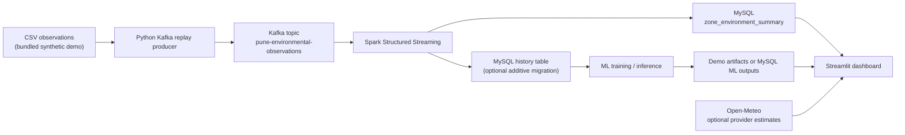

# GreenPulse Pune

**Environmental intelligence and hotspot-detection dashboard**

GreenPulse Pune is a local Streamlit prototype for exploring land-surface temperature (LST), vegetation index (NDVI), optional provider-estimated weather and air quality, and ML workflow outputs. It combines a Kafka replay producer, Spark Structured Streaming, MySQL persistence, and a dashboard. The bundled Pune-area observations are **synthetic demonstration data, not measured Pune conditions**. The project does not claim to have reduced heat, pollution, or electricity consumption.

> **Data disclosure:** The CSV in `data/pune_demo_observations.csv` contains 144 synthetic rows for 18 illustrative zone names over eight dates. Its source is `SYNTHETIC_DEMO_NOT_REAL`. Zone coordinates are approximate points, not verified ward boundaries. Air-quality API responses, when available, are provider/model estimates for one approximate Pune grid point. Zone-level electricity values are simulated, not utility measurements.

## Contents

- [Project overview and system architecture](#overview)
- [Implemented scope and status](#implemented-scope-and-status)
- [Results and outputs](#results-and-outputs)
- [Technology stack](#technology-stack)
- [Quick start](#quick-start-windows-powershell)
- [Optional Kafka and Spark replay](#optional-kafka-and-spark-replay)
- [ML demo and real-data workflow](#machine-learning)
- [Tests](#tests)
- [Screenshots](#screenshots)
- [Technical documentation](#technical-documentation)
- [Limitations and future work](#limitations)
- [References](#references)

## Overview

The prototype is intended to help students and reviewers explore environmental observations, compare illustrative zones, and understand how a small streaming-and-ML application can be organized. It is a decision-support demonstration, not an official alert system or a substitute for verified environmental monitoring.

### System architecture



**Figure 1. System architecture summary.** It separates replay/stream processing from the dashboard, optional provider estimates, and the isolated ML workflow.

The CSV-to-Kafka path is a replay, not a live sensor or satellite feed. Spark writes the established latest-batch summary and, when the additive migration exists, separately stores zone/date history. The dashboard reads the latest summary and refreshes its view independently of pipeline execution. Synthetic ML demo artifacts are isolated from the real-data model directory and are not written to MySQL.

See [the architecture chapter](docs/03_SYSTEM_ARCHITECTURE.md), [the end-to-end workflow](docs/04_END_TO_END_WORKFLOW.md), and [diagram sources](docs/diagrams/).

## Implemented scope and status

| Component | Verified implementation/status |
|---|---|
| Streamlit dashboard | Implemented with Pune overview, heat-hotspot review, air quality, electricity hotspots, ML predictions/recommendations, and data/pipeline status. Zone Explorer is a section of the overview. |
| MySQL latest summary | The app connected successfully during inspection. `greenpulse_pune.zone_environment_summary` contains 18 zone rows for batch 4 and observation date 2025-07-06. |
| Kafka producer | Python producer replays CSV records to `pune-environmental-observations`; default input is synthetic. |
| Spark streaming | Code consumes Kafka JSON events, aggregates per zone, and writes MySQL summaries. A separate history sink is enabled only when its table exists. Current runtime health is not asserted by this README. |
| ML real-data workflow | Implemented with source screening and minimum history requirements. The inspected MySQL history table had zero rows and therefore did not support eligible real-data model training. |
| ML demo workflow | Implemented and previously run against the synthetic CSV. It produced a demo-only model report, 18 next-observation estimates, 13 recommendations, and charts. These are not real-world validation. |
| Air quality | Open-Meteo requests are implemented. Values are model/provider estimates for one approximate city grid point and appear only when the call succeeds. |
| Electricity | Illustrative/simulated index only; no measured utility dataset is connected. |
| Geographic map | Markers use CSV coordinates matched by zone ID. The bundled points are explicitly approximate and are not ward polygons. |

Detailed boundaries and qualifications are documented in [requirements and scope](docs/02_REQUIREMENTS_AND_SCOPE.md) and [limitations](docs/12_LIMITATIONS_AND_FUTURE_SCOPE.md).

## Results and outputs

The inspected database readiness report recorded 18 latest-summary rows, 18 zones, one observation date (2025-07-06), one batch, 288 received source records, and a processing timestamp of 2026-10-25 20:02:31. This historical database write is not evidence that Kafka or Spark is currently running.

The bundled synthetic CSV contains 144 rows (18 zones × 8 dates, 2025-03-15 to 2025-07-06). In that file, LST ranges from 31.35°C to 44.12°C (mean 38.018°C) and mean NDVI is 0.4047. These are synthetic demonstration values only. The latest database summary's hottest zone is Hadapsar at 40.035°C on 2025-07-06, also derived from the synthetic replay. A single eight-date synthetic series cannot establish a real Pune trend.

The most recent saved synthetic demo holdout report shows candidate Random Forest MAE 2.009°C and RMSE 2.465°C versus mean-baseline MAE 3.661°C and RMSE 4.104°C, using 36 held-out rows across two late dates. Both R² values are negative. These small synthetic-only metrics illustrate the software flow; they do not demonstrate a useful or accurate real-data forecast. Full evidence and interpretation are in [Results and Findings](docs/14_RESULTS_AND_FINDINGS.md).

## Technology stack

| Technology | Version evidence | Purpose | Where used | Reason in this project |
|---|---|---|---|---|
| Python | README recommends 3.10/3.11; inspected local interpreter 3.13.15; interpreter not pinned | Application, producer, ML utilities | Root `.py` files and `ml/` | Existing language/runtime for the prototype |
| Streamlit | `>=1.66,<2`; inspected 1.66.1 | Dashboard pages, controls, status and charts | `app.py`, `ml/dashboard.py` | Existing lightweight Python dashboard framework |
| streamlit-autorefresh | `>=1.0.1,<2`; inspected 1.0.1 | Periodic dashboard refresh | `app.py` | Refreshes UI data without claiming to run the pipeline |
| Pandas / NumPy | Manifest ranges; inspected 2.3.3 / 2.5.4 | Tabular validation, features and numeric operations | `ml/`, `app.py` | Existing data-processing dependencies |
| Plotly / PyDeck | Manifest ranges; inspected 6.9.0 / 0.9.3 | Charts and map visualization | `app.py`, ML dashboard | Existing visualization dependencies |
| scikit-learn | `>=1.4,<2`; inspected 1.9.1 | Baseline and Random Forest regression | `ml/trainer.py`, inference | Existing ML implementation |
| MySQL Connector/Python | `>=8.3,<10`; inspected 26.10.0 | Database reads and writes | `app.py`, `ml/database.py`, `spark_streaming.py` | Existing MySQL integration |
| Apache Kafka / `kafka-python` | Image `apache/kafka:3.7.0`; package `>=2.0.2,<3`, inspected 2.3.2 | Local event transport and CSV replay | `docker-compose.yml`, `kafka_producer.py` | Demonstrates decoupled event ingestion |
| Apache Spark / PySpark | `pyspark==4.2.0`; connector compatibility needs verification | Batch and streaming transformation | `spark_batch.py`, `spark_streaming.py` | Existing distributed-processing demonstration |
| Docker Compose | Compose file uses Kafka 3.7.0; Engine version not verified | Starts optional local Kafka service | `docker-compose.yml` | Reproducible local broker service |
| Requests / Open-Meteo | `requests>=2.31,<3`; inspected 2.34.2 | Optional provider weather/AQ requests | `app.py` | Retrieves estimates when the external API is reachable |

The inspected local package versions are environment snapshots, not pinned lockfile guarantees. See [setup and execution](docs/10_SETUP_AND_EXECUTION.md) for sources and commands.

## Project structure

```text
greenpulse_pune_demo/
├── app.py                         # Streamlit dashboard and page routing
├── kafka_producer.py              # CSV-to-Kafka replay producer
├── spark_streaming.py             # Kafka consumer and MySQL streaming sinks
├── spark_batch.py                 # Optional batch Spark analysis
├── ml_analysis.py                 # Legacy synthetic exploratory analysis
├── utils.py                       # Shared dashboard/data utilities
├── data/
│   ├── pune_demo_observations.csv  # Synthetic demo observations
│   └── README_DATA.md              # Dataset field notes
├── database/
│   └── migrations/
│       └── 001_environmental_ml.sql
├── ml/                             # Validation, features, model, inference,
│                                   # hotspot rules, recommendations, dashboard
├── tests/
│   └── test_ml_pipeline.py
├── outputs/                        # Runtime reports, checkpoints, artifacts
├── docs/
│   ├── diagrams/                   # Editable Mermaid sources
│   ├── figures/                    # Report figures generated from demo data
│   └── screenshots/                # Empty until genuine app screenshots added
├── requirements.txt
├── requirements-streaming.txt
├── docker-compose.yml
├── RESEARCH_REFERENCES.md
├── HOW_TO_USE.txt
├── .gitignore
├── .streamlit/                    # Local Streamlit secrets; never commit
├── .agents/                       # Project-local Streamlit skill notes
└── .claude/                       # Project-local Streamlit skill notes
```

The diagram excludes virtual environments, local credentials, caches, and generated output files. `outputs/` is runtime state; its saved demo reports are not source datasets.

## Quick start (Windows PowerShell)

Open PowerShell in the repository directory:

```powershell
cd "C:\path\to\greenpulse_pune_demo"
py -m venv .venv
.\.venv\Scripts\Activate.ps1
python -m pip install --upgrade pip
pip install -r requirements.txt
streamlit run app.py
```

Open `http://localhost:8501`. If PowerShell blocks virtual-environment activation, run `Set-ExecutionPolicy -Scope Process -ExecutionPolicy Bypass` in that terminal, then activate again. Do not paste the PowerShell prompt, JSON report, or tool output as commands; run only the command lines.

### MySQL configuration

The dashboard accepts `MYSQL_HOST`, `MYSQL_PORT`, `MYSQL_USER`, `MYSQL_PASSWORD`, and `MYSQL_DATABASE`. Credentials may also be provided through a local `[mysql]` section in `.streamlit/secrets.toml`. Keep that file private and out of commits; use a local placeholder-only example if documenting your own setup. Spark uses the `MYSQL_*` environment variables, including `MYSQL_PASSWORD`.

For the current PowerShell session, enter the password without placing it in command history:

```powershell
$env:MYSQL_HOST = "127.0.0.1"
$env:MYSQL_PORT = "3306"
$env:MYSQL_USER = "root"
$env:MYSQL_DATABASE = "greenpulse_pune"
$securePassword = Read-Host "MySQL password" -AsSecureString
$env:MYSQL_PASSWORD = [System.Net.NetworkCredential]::new("", $securePassword).Password
```

See [database design](docs/06_DATABASE_DESIGN.md) and [secure setup](docs/10_SETUP_AND_EXECUTION.md). The base `zone_environment_summary` table is part of the existing database setup; the repository migration is additive and does not create or change that summary table.

## Optional Kafka and Spark replay

Kafka and Spark are optional for viewing the dashboard if MySQL already contains the summary. In separate PowerShell windows, from the project directory:

```powershell
docker compose up -d kafka
pip install -r requirements-streaming.txt
python kafka_producer.py
```

The producer sends the bundled synthetic CSV by default. Start the Spark consumer in a separate window after configuring the MySQL environment variables:

```powershell
spark-submit --packages org.apache.spark:spark-sql-kafka-0-10_2.13:4.2.0 spark_streaming.py
```

The connector coordinate above follows the project's PySpark 4.2.0 dependency and must be checked against the installed Spark/Scala distribution if the package cannot be resolved. Topic: `pune-environmental-observations`; broker: `localhost:9092`. For a local topic setup command, migration notes, replay behavior, and current verification status, see [Kafka and Spark streaming](docs/05_KAFKA_SPARK_STREAMING.md). Stop producer/Spark with `Ctrl+C`; stop the Compose broker with `docker compose down`.

## Machine learning

The older `python ml_analysis.py` script is a separate synthetic exploration using K-means and a randomly split Random Forest regression. It writes `outputs\zone_analysis.csv` and `outputs\model_metrics.json`; its random holdout metrics are not an out-of-time forecast evaluation. Prefer the explicit isolated demo mode below for the current ML dashboard workflow.

The explicit synthetic demo is isolated and does not require MySQL, Kafka, or Spark:

```powershell
python -m ml.train_model --demo
python -m ml.predict --demo
```

Its artifacts are written under `outputs\ml\demo_artifacts\`; do not pass them off as measured Pune forecasts. The standard real-data workflow is:

```powershell
python -m ml.data_readiness
python -m ml.train_model
python -m ml.predict
```

Real training uses eligible, source-tagged, non-demonstration records from `environment_observations`. The currently inspected history table had zero records. Training therefore remains blocked until sufficient reviewed history is collected; see [ML methodology](docs/07_MACHINE_LEARNING.md).

The optional `spark_batch.py` script separately aggregates the bundled CSV and writes Parquet under `outputs\spark_batch`; this is a local batch demonstration, not the Kafka streaming job.

## Tests

Run the focused unit suite from the activated project environment:

```powershell
python -m unittest tests.test_ml_pipeline -v
```

The repository contains eight ML pipeline unit tests; all eight passed when run during this documentation pass. Earlier Streamlit AppTest also rendered the overview and ML page without exceptions. Kafka/Spark end-to-end execution was not verified. The distinction between unit, application, and integration evidence is in [Testing and validation](docs/11_TESTING_AND_VALIDATION.md).

## Screenshots

No report-ready screenshots are currently committed. The available integrated browser returned incomplete/blank captures, so no screenshot is presented as evidence. See [the screenshot capture instructions](docs/screenshots/README.md) and [dashboard guide](docs/09_DASHBOARD_AND_USER_WORKFLOW.md) to capture the actual running pages manually. Do not replace these with mockups.

## Technical documentation

| Chapter | Document |
|---|---|
| 01 | [Project overview](docs/01_PROJECT_OVERVIEW.md) |
| 02 | [Requirements and scope](docs/02_REQUIREMENTS_AND_SCOPE.md) |
| 03 | [System architecture](docs/03_SYSTEM_ARCHITECTURE.md) |
| 04 | [End-to-end workflow](docs/04_END_TO_END_WORKFLOW.md) |
| 05 | [Kafka and Spark streaming](docs/05_KAFKA_SPARK_STREAMING.md) |
| 06 | [Database design](docs/06_DATABASE_DESIGN.md) |
| 07 | [Machine learning](docs/07_MACHINE_LEARNING.md) |
| 08 | [Hotspot and recommendation engine](docs/08_HOTSPOT_AND_RECOMMENDATION_ENGINE.md) |
| 09 | [Dashboard and user workflow](docs/09_DASHBOARD_AND_USER_WORKFLOW.md) |
| 10 | [Setup and execution](docs/10_SETUP_AND_EXECUTION.md) |
| 11 | [Testing and validation](docs/11_TESTING_AND_VALIDATION.md) |
| 12 | [Limitations and future scope](docs/12_LIMITATIONS_AND_FUTURE_SCOPE.md) |
| 13 | [Data sources and references](docs/13_DATA_SOURCES_AND_REFERENCES.md) |
| 14 | [Results and findings](docs/14_RESULTS_AND_FINDINGS.md) |

The seven editable Mermaid diagram sources are in [`docs/diagrams/`](docs/diagrams/).

## Limitations

- The bundled LST/NDVI values and coordinates are synthetic and illustrative.
- The database summary is a single-date latest-batch view, not a time series; the history table was empty at inspection.
- Zone-level air quality and electricity measurements are not available. Electricity is simulated; Open-Meteo, when reachable, supplies a single-point provider estimate.
- Predictions and threshold-based recommendations are exploratory decision-support demonstrations, not official alerts, causal findings, or validated intervention guidance.
- Zone marker points do not represent official ward boundaries.
- Dashboard refresh does not establish pipeline health or create newer source observations.

See [limitations and future scope](docs/12_LIMITATIONS_AND_FUTURE_SCOPE.md) for actions needed to overcome these constraints.

## References

References and source provenance are recorded in [Data Sources and References](docs/13_DATA_SOURCES_AND_REFERENCES.md) and the existing [research reference notes](RESEARCH_REFERENCES.md). Review the actual dataset license and metadata before using an external dataset in research.

## Contributors

Contributor names are not recorded in the inspected project files; add the project team's verified names before submitting a formal report.
