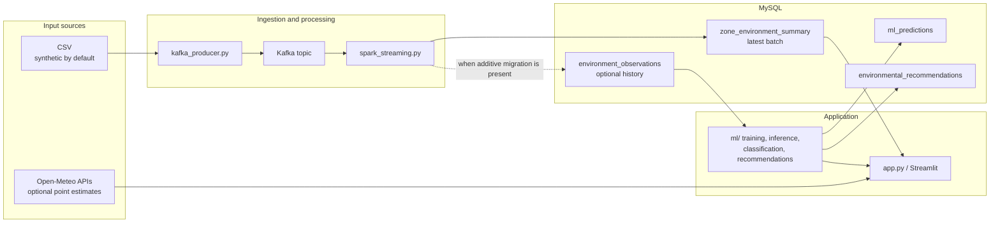

# 03. System architecture

## Architecture summary

The local prototype is composed of a dashboard, an optional replay/streaming path, a MySQL persistence layer, and a separate ML workflow. The CSV is not a live data source. Open-Meteo is an optional direct API call made by the dashboard; it is not ingested into the Spark/MySQL environmental observation schema.

**Figure 3.1.** Implemented logical architecture. Dashed history storage is conditional on the additive migration; the `ml_predictions` and `environmental_recommendations` tables are defined in that migration. The actual dashboard can also display isolated local demo artifacts without MySQL ML rows.

## Component responsibilities

| Component | Input | Processing/output |
|---|---|---|
| `kafka_producer.py` | CSV selected by `GREENPULSE_DATASET_PATH`; bundled synthetic CSV by default | Converts numeric fields and publishes JSON to `pune-environmental-observations`. |
| Kafka broker | Producer JSON messages | Local topic transport on `localhost:9092`, configured in `docker-compose.yml`. |
| `spark_streaming.py` | Kafka values | Parses/filters required LST and NDVI, aggregates by zone, writes latest summary; optionally writes date/source history. |
| MySQL | Aggregates and history | Stores latest summaries and, if migrated, additional ML-related history/results. |
| `ml/` package | Reviewed historical observation records or explicit demo CSV | Validates source/measurements; makes temporal features; trains, evaluates, predicts, classifies, and generates suggestions. |
| `app.py` | Latest MySQL summary, CSV coordinate reference, optional provider APIs | Renders overview and module pages. |

## Process and status boundaries

The processes are independent. Starting Streamlit does not start Kafka, Spark, or the producer. The dashboard's auto-refresh refreshes selected data loads only; it is not a pipeline scheduler. The app checks limited broker TCP reachability, not Kafka protocol, topic production, consumer lag, or Spark process health. A successful historical MySQL write does not prove that the streaming processes are running now.

## Failure and missing-data behavior

The dashboard catches the expected database/API errors and presents errors or unavailable states. Missing API data are not replaced by simulated observations. The Spark history sink is skipped if `environment_observations` is absent, while the established summary sink remains. Credentials are external configuration and must not be embedded in code or documentation.

## Related diagrams

- [Architecture source](diagrams/01_system_architecture.mmd)
- [End-to-end data flow](diagrams/02_end_to_end_data_flow.mmd)
- [Kafka/Spark sequence](diagrams/03_kafka_spark_sequence.mmd)
- [Local runtime](diagrams/07_local_runtime_architecture.mmd)
