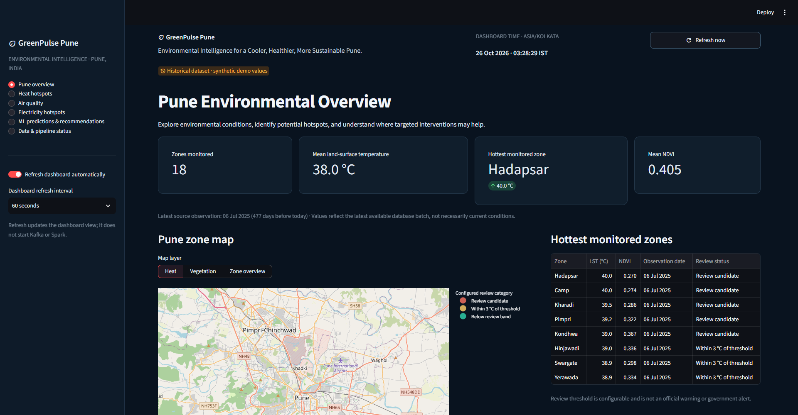
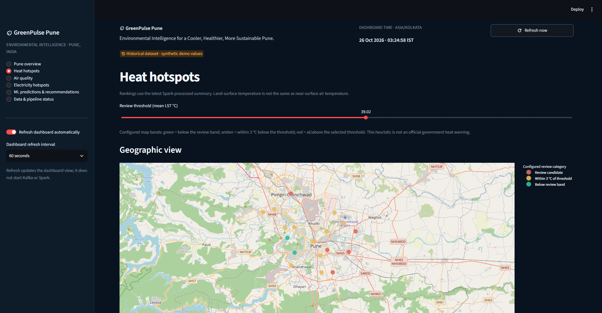
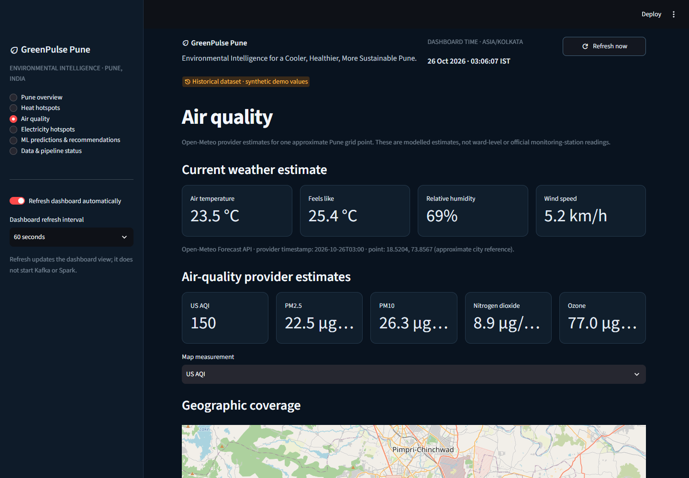
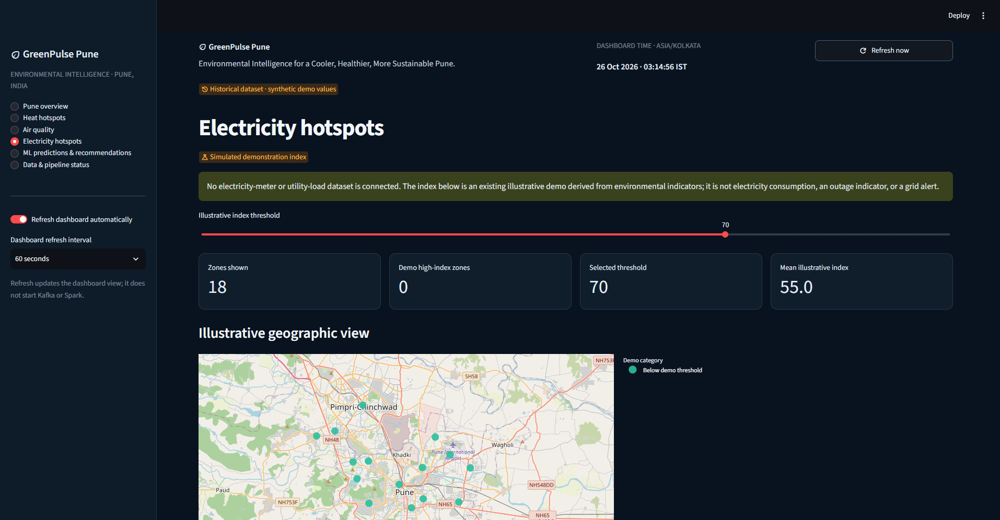
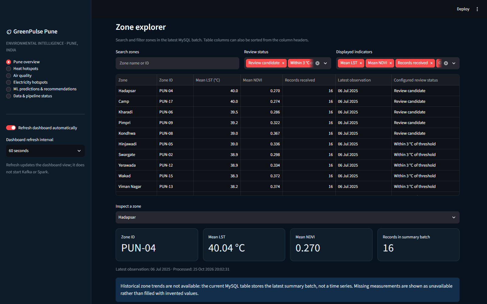
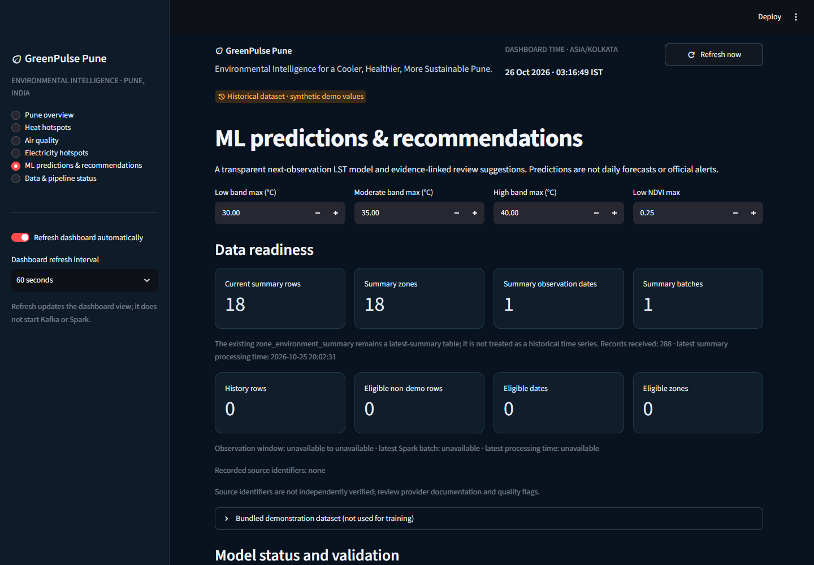
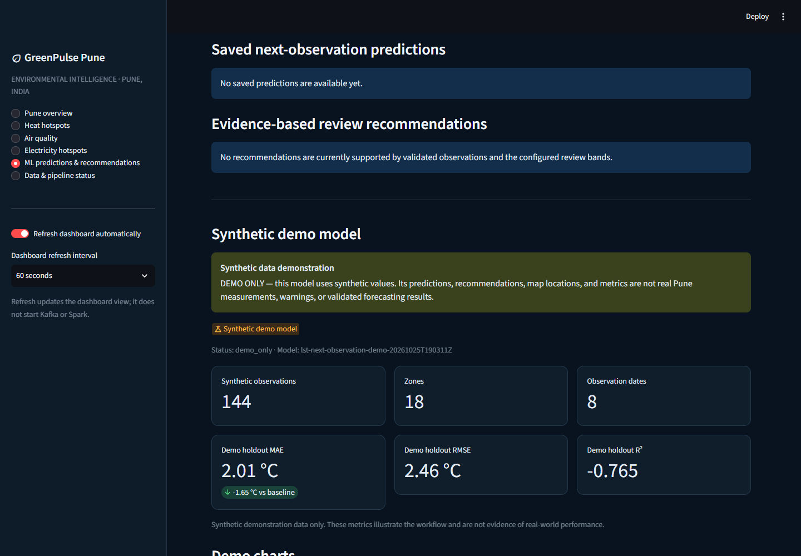
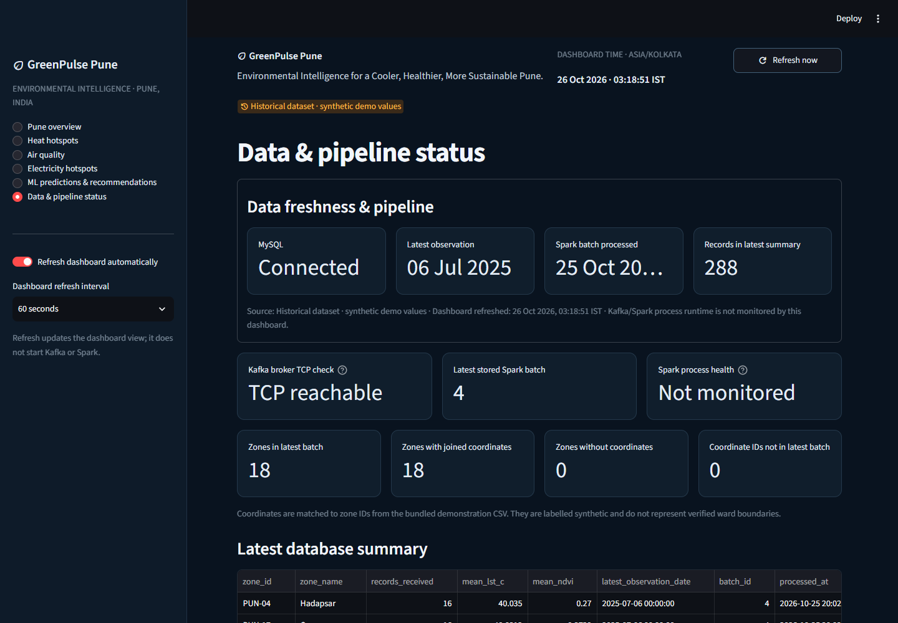

# 09. Dashboard and user workflow

## Navigation

The Streamlit sidebar presents the following pages:

1. Pune overview
2. Heat hotspots
3. Air quality
4. Electricity hotspots
5. ML predictions & recommendations
6. Data & pipeline status

Zone Explorer is embedded in the Pune overview. The sidebar refresh control updates the dashboard view; it does not start or monitor Kafka/Spark. The header reports a dashboard timestamp in `Asia/Kolkata`, while observation and processing times are shown separately.

## Screens and data interpretation

| Screen | Purpose and content | Interaction / source / limitation |
|---|---|---|
| Pune overview | Latest-batch zone KPIs, map, ranked hottest zones, Zone Explorer, freshness/status, optional current provider estimates. | Refresh, map layer, zone search/filter/sort. Summary from MySQL; map/source lookup from bundled CSV; marker points are approximate and synthetic. |
| Heat hotspots | Ranked zone LST and exploratory heat-band review. | User can adjust review controls and inspect zone rows/map. Latest summary only; no real historical trend in summary table. |
| Air quality | Current Open-Meteo air-quality estimates if request succeeds. | Displays provider timestamp and approximate central Pune grid point. Not an official station or citywide zone map; no replacement value when API is unavailable. |
| Electricity hotspots | Illustrative zone index/map for demonstrating navigation and comparison. | Derived/simulated, not utility meter or feeder consumption data. |
| ML predictions & recommendations | Data readiness, model status, synthetic-demo or real model outputs, evidence, and available charts. | Demo chart mode reads local synthetic artifacts. Real mode requires the additive history table to contain sufficient eligible observations. |
| Data & pipeline status | Database status, observation/processing/dashboard times, source information, and limited broker connectivity indicator. | Does not claim Spark process health; broker check is only TCP reachability. |
| Zone Explorer | Searchable/filterable latest summary table embedded on overview. | Values come from latest MySQL batch. This is not a time-series explorer. |

The dashboard uses Plotly/PyDeck/native Streamlit visuals. Missing DB or API data is shown as unavailable/error rather than fabricated. API estimates and synthetic/simulated data are separately labelled.

**Figure 9.1.** Sidebar navigation and the dashboard's data-readiness branches, including the synthetic demo, real-history, and unavailable states. [Editable dashboard workflow](diagrams/06_dashboard_user_workflow.mmd).

## Maps and geographic precision

The MySQL summary does not contain coordinates. The app joins CSV coordinates by `zone_id`; the bundled points are illustrative. They are not verified geographic measurements, ward boundaries, or evidence of precise spatial hotspots. A reliable zone map requires validated coordinates with quality/provenance metadata or licensed geographic polygons and spatial joins.

## Screenshots

The following images were captured from the running local Streamlit app. They document the UI state at capture time; live provider estimates and timestamps can change.

**Figure 9.2. Pune overview.** Latest-batch summary, approximate zone map, and ranked zones. The orange badge identifies the synthetic demonstration values.

**Figure 9.3. Heat-hotspot review.** Map categories and review threshold are exploratory, not official warnings.

**Figure 9.4. Air-quality estimates.** Provider/model values for one approximate grid point, not ward-level measurements.

**Figure 9.5. Electricity demonstration.** The index is simulated; no electricity-meter or utility-load dataset is connected.

**Figure 9.6. Zone Explorer.** Search and filters over the latest summary batch; this is not a historical time-series view.

**Figure 9.7. ML data readiness.** The current summary has rows, but eligible non-demo history is absent.

**Figure 9.8. ML synthetic-demo evidence.** The model report is labelled demo-only; the page also indicates that prediction/recommendation rows are not saved in MySQL.

**Figure 9.9. Data and pipeline status.** The page distinguishes database connectivity and Kafka TCP reachability from Spark process health, which is not monitored.

See the [screenshot gallery and capture notes](screenshots/README.md). For the result evidence and interpretation structure, see [chapter 14](14_RESULTS_AND_FINDINGS.md).
