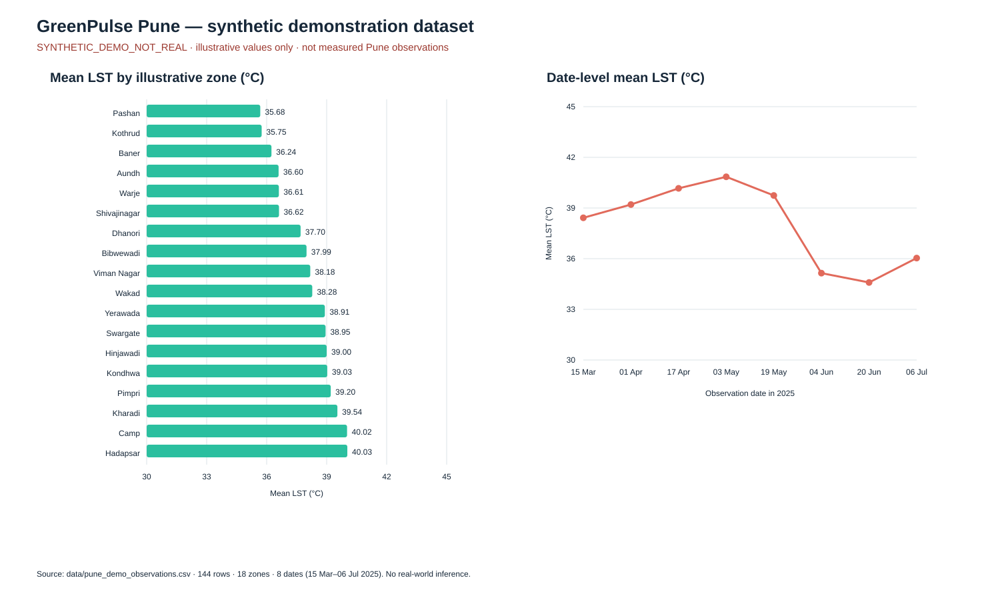

# 14. Results and findings

## Scope and evidence

This chapter reports the state inspected in the local project: the bundled CSV, saved readiness and synthetic ML reports, the configured MySQL database, the source code, and previously recorded unit/AppTest results. The data file is explicitly synthetic. Database persistence of that file does not turn it into a measurement. Values and model metrics below are therefore software-demo evidence, not empirical environmental findings about Pune.

## 1. Overall system execution

The Streamlit dashboard was accessible on the local machine during inspection and presented the Pune overview, latest database summaries, approximate zone map, hotspot ranking, zone table, and optional provider estimate section. Source files also implement Air Quality, Electricity Hotspots, ML Predictions and Recommendations, and Data & Pipeline Status screens. The ML demo artifacts were present and contained synthetic predictions and recommendations. These observations support the implemented local application behavior but do not establish production readiness.

MySQL connectivity succeeded during direct schema inspection. The latest observed summary consisted of 18 rows for batch 4, one row per zone, and 288 source records received. The stored `processed_at` value was 2026-10-25 20:02:31 while its environmental observation date was 2025-07-06. This is evidence of a historical replay being processed later, not of a recent environmental observation.

Kafka message publishing and Spark consumer execution were not independently verified in this documentation pass. Although the producer and streaming consumer are implemented, the MySQL snapshot alone is not proof of current broker or Spark operation. The optional history table existed but had no rows at inspection; the ML prediction and recommendation tables also had no rows. Demo ML outputs were local files, not database records.

## 2. Environmental data analysis results

### 2.1 Bundled synthetic observation file

The file `data/pune_demo_observations.csv` contains 144 rows, 18 illustrative zones, and eight distinct dates from 2025-03-15 through 2025-07-06. Every row carries the provenance label `SYNTHETIC_DEMO_NOT_REAL`. Its row-level LST mean is 38.018°C, minimum 31.35°C, and maximum 44.12°C; mean NDVI is 0.4047. The highest single row is Camp at 44.12°C with NDVI 0.193 on 2025-05-03. These values characterize only the generated sample. They are not measured results for Camp or any other Pune neighborhood.

**Figure 14.1. Synthetic dataset LST summary.** The left panel shows row-mean LST for each illustrative zone; the right panel shows date-level means across the synthetic rows. The graphic was generated from the bundled CSV. Variation in this generated series must not be interpreted as a real Pune temporal trend.

### 2.2 Latest MySQL summary

The database's latest summary has 18 zones, all on 2025-07-06. Averaging the 18 zone summaries gives LST 38.018°C and NDVI 0.4047; zone summary LST spans 35.679°C to 40.035°C. The hottest summarized zone is Hadapsar (40.035°C, NDVI 0.2700). The values match the synthetic replay snapshot and are not independent observations.

**Table 14.1. Highest latest-batch zone summaries in MySQL (batch 4; synthetic replay; 2025-07-06).**

| Rank | Zone | Mean LST (°C) | Mean NDVI | Observation date | Records received |
|---:|---|---:|---:|---|---:|
| 1 | Hadapsar | 40.035 | 0.2700 | 2025-07-06 | 16 |
| 2 | Camp | 40.021 | 0.2739 | 2025-07-06 | 16 |
| 3 | Kharadi | 39.536 | 0.2863 | 2025-07-06 | 16 |
| 4 | Pimpri | 39.203 | 0.3219 | 2025-07-06 | 16 |
| 5 | Kondhwa | 39.031 | 0.3668 | 2025-07-06 | 16 |

The ranking describes the persisted latest synthetic batch only. It cannot show repeatability, causation, neighborhood risk, or official ward boundaries. The row-level CSV maximum (44.12°C in Camp on 2025-05-03) differs from the latest summary maximum (Hadapsar, 40.035°C on July 6) because the statistics cover different grains and dates.

### 2.3 Air quality and electricity

The bundled observations contain no air-quality or electricity measurement fields. The app has an optional Open-Meteo Air Quality API request for US AQI, PM2.5, PM10, nitrogen dioxide, and ozone at one approximate Pune point. These are provider/model estimates and are only available when a request succeeds; they are not persisted as a zone time series. The electricity page is simulated/illustrative, so no actual consumption result can be reported.

## 3. Kafka, Spark, and MySQL execution results

Direct MySQL inspection confirmed the schema and these latest-batch results:

| Item | Observed result |
|---|---|
| Database/table | `greenpulse_pune.zone_environment_summary` |
| Latest batch | 4 |
| Rows/zones | 18 / 18 |
| Observation dates | One: 2025-07-06 |
| `records_received` total | 288 (16 per zone) |
| `processed_at` | 2026-10-25 20:02:31 |
| History table | Exists; 0 rows in saved readiness report |
| ML prediction/recommendation tables | Present; 0 rows in inspected database |

Spark source code filters records missing zone ID, LST, or NDVI, writes complete per-zone batch aggregates, and uses MySQL upsert behavior. A second sink writes zone/date/source history when the migration is present. These are code-level findings. The inspected database contents provide evidence that summaries were written at some time, but no current Kafka publish log, Spark batch log, or end-to-end test was collected for this results chapter. A timestamp in MySQL must not be presented as proof that the streaming service is currently running.

## 4. Machine-learning results

### 4.1 Synthetic chronological evaluation

The saved model report is marked `demo_only` and identifies model version `lst-next-observation-demo-20261025T190311Z`. It used 144 valid synthetic records to create 108 supervised rows; 72 supervised rows were used for training and 36 were held out across the two later dates 2025-06-20 and 2025-07-06. The target is next-observation LST, not daily temperature.

**Table 14.2. Synthetic-only chronological holdout metrics.**

| Model | MAE (°C) | RMSE (°C) | R² |
|---|---:|---:|---:|
| Mean baseline | 3.661 | 4.104 | -3.893 |
| Random Forest candidate | 2.009 | 2.465 | -0.765 |

The candidate improves on the mean baseline for MAE and RMSE on this particular synthetic holdout and satisfies the code's demo acceptance comparison. Both R² values are negative, and the evaluation covers only two late dates generated synthetically. Therefore, this comparison demonstrates the evaluation pipeline, not reliable generalization or forecast skill for Pune.

**Table 14.3. Representative synthetic holdout actual-versus-predicted values.**

| Holdout date | Zone ID | Actual LST (°C) | Predicted LST (°C) |
|---|---|---:|---:|
| 2025-06-20 | PUN-01 | 33.11 | 33.46 |
| 2025-07-06 | PUN-01 | 34.59 | 33.51 |
| 2025-06-20 | PUN-02 | 36.08 | 34.28 |
| 2025-07-06 | PUN-02 | 36.73 | 33.39 |

These rows are examples from the saved holdout output, not a separate measured dataset. Several estimates underpredict their synthetic actual values; together with the negative R² and two-date test, this should not be taken as evidence of forecast quality.

### 4.2 Predictions and recommendations

The saved demo inference file contains 18 synthetic next-observation estimates from input date 2025-07-06 for target date 2025-07-22 (16 days, based on the median synthetic cadence). Predicted LST values range from 33.413°C to 37.511°C. For example, Kharadi is estimated at 37.511°C with an empirical error band of 33.365–41.657°C. The band is based on a chronological holdout error quantile; it is not a calibrated confidence interval.

The same output contains 13 recommendations, all of `issue_type=observed`; each is labelled synthetic-only and carries supporting evidence. No forecast-plus-low-NDVI recommendation was counted in this artifact. Suggestions are threshold-driven prompts for review, not official warnings or proof that an intervention will work.

The demo report uses the same regression code path and feature pipeline as a workflow illustration but has relaxed demo-only data minimums. Real mode requires substantially more reviewed history; the inspected history table was empty, so no valid real-data metrics or forecasts are reported.

## 5. Key findings

1. **Latest summarized zone:** Hadapsar has the highest MySQL summary mean LST at 40.035°C on 2025-07-06, narrowly above Camp at 40.021°C. The supporting rows belong to a synthetic replay. This ranking is a demonstration, not a claim about observed neighborhood temperatures.
2. **Vegetation values vary in the sample:** the latest summary contains different NDVI values across zones, with mean 0.4047 across the 18 zone summaries and Hadapsar at 0.2700. The sample is synthetic, and this association alone cannot explain temperature differences.
3. **No defensible temporal finding:** eight dates appear in the bundled synthetic CSV, but the database latest-summary table contains only one date and its history table was empty. The data do not support a real Pune trend or real-data time-series model.
4. **Air quality and electricity evidence is incomplete:** there are no persisted zone-level AQ/electricity observations. One-point Open-Meteo outputs are provider estimates; electricity outputs are simulated. Neither supports a zone ranking of real air quality or power demand.
5. **Data pipeline implementation is present, but current operation is unverified:** the stored 18-row batch is historical database evidence; no current Kafka/Spark integration log was collected. A new observation and separate run evidence are needed before describing the pipeline as currently active.
6. **Synthetic model comparison:** candidate MAE/RMSE are numerically lower than the mean baseline on the two-date generated holdout, but both R² values are negative. This is insufficient to claim that the model contributes useful predictive information on real data.

## 6. Limitations observed during testing

The project has insufficient real historical data for model evaluation, only approximate unverified zone markers, no persisted air-quality or electricity series, and no current end-to-end Kafka/Spark test evidence. The database processing timestamp is later than the environmental observation date, demonstrating why freshness must distinguish processing from observation. The app's data status page also cannot establish Spark process health. Next steps are to collect source-verified observations over adequate dates, obtain valid geographic boundaries, integrate authorized measured air-quality/electricity data if in scope, and run integration checks with recorded logs.

## 7. Website screenshot status

**No valid website screenshots were captured for this report.** The local app was reachable, but available browser screenshot automation produced incomplete/blank image files, which were not retained as evidence. The application pages and their data sources are documented in [chapter 09](09_DASHBOARD_AND_USER_WORKFLOW.md). Capture the real local app using [the screenshot checklist](screenshots/README.md), then add only genuine images to this chapter and the README. Required manual captures include overview, heat, air-quality availability state, electricity simulation state, Zone Explorer, ML outputs, and data/pipeline status.

## Conclusion

The inspected evidence supports that the local dashboard, its MySQL summary query, synthetic ML demo workflow, and heuristic output files are implemented. The database contains an 18-zone, single-date synthetic replay. The source tree contains Kafka/Spark streaming code, but current end-to-end operation was not verified. As a result, the project is suitable as a software and classroom demonstration; stronger environmental or predictive conclusions require verified data, longer histories, validated geography, and integration/model evaluation evidence.
